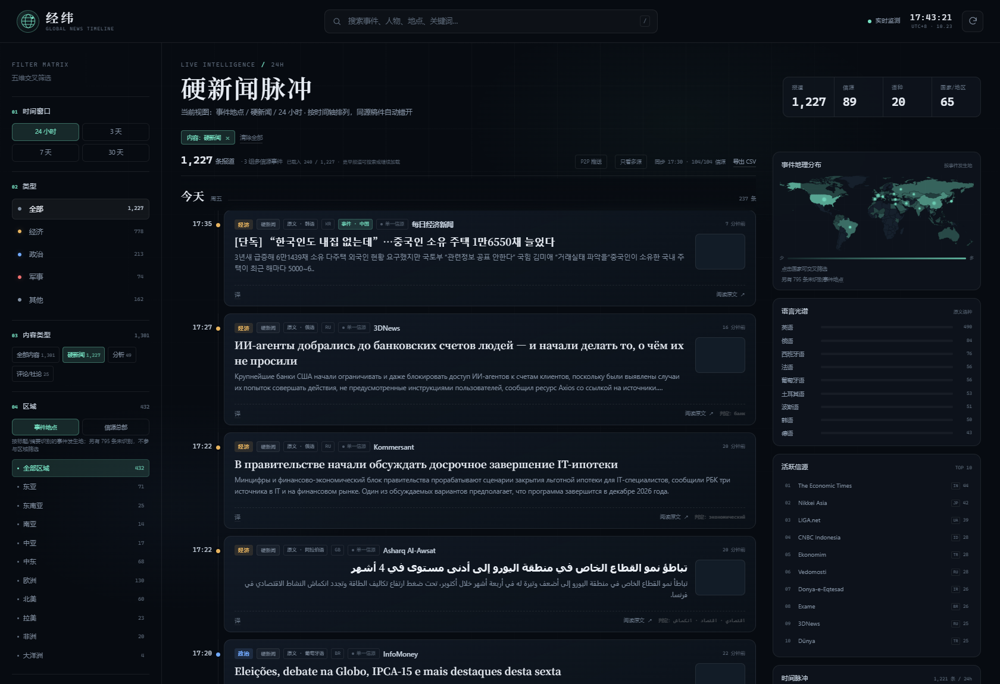
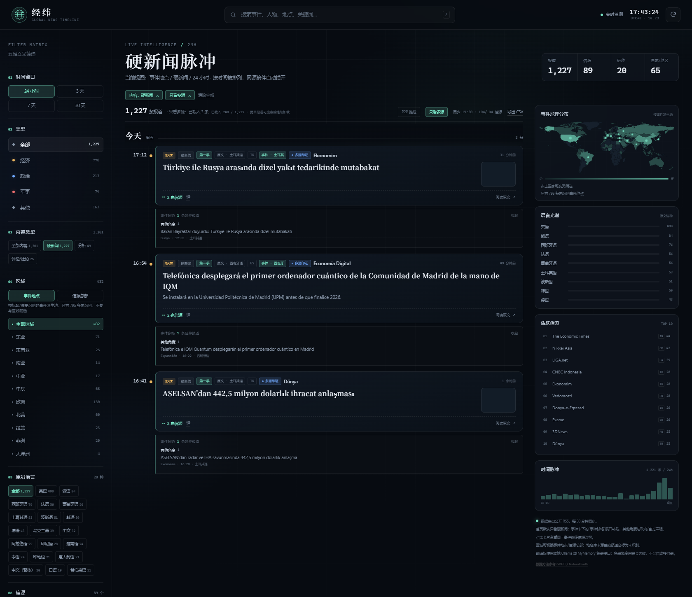
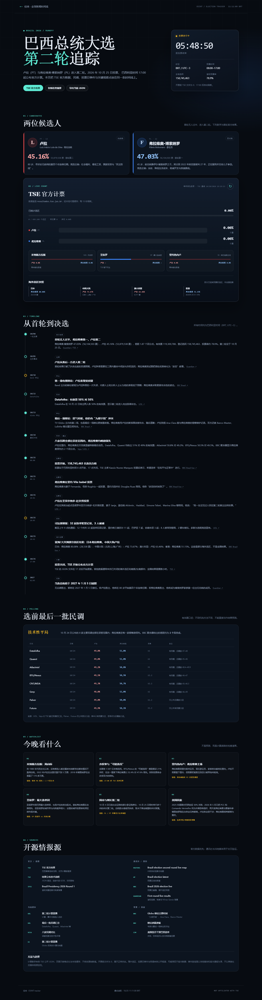

# 经纬 · Global News Timeline

> 按 **区域 / 信源 / 原始语言 / 类型（经济·政治·军事）/ 内容形态（硬新闻·分析·评论）** 追踪全球新闻时间线的本地优先工具。默认信源全部为各语言、各地区的专业媒体，不使用综合门户或新闻聚合器。

| 主界面（硬新闻首页） | 首页事件脉络 |
|---|---|
|  |  |

| 跨语言事件 | 交叉检验 |
|---|---|
|  |  |

| 搜索汇总 | P2P 接收端 |
|---|---|
|  |  |

| 翻译（免费优先/可配 API） | 移动端 |
|---|---|
|  |  |

- **一个 Python 进程**：只用标准库，无 npm、无构建步骤、无数据库服务。
- **本地 SQLite**：标题、摘要、来源、时间、原文链接；不抓全文、不做全文再分发。
- **111 个专业信息源（全部启用）**：109 个直连 RSS/Atom 专业媒体/版块 + 1 个 Polymarket 预测市场 API + 1 个金十数据快讯 API，0 聚合器，覆盖 17 种语言、30 个国家/地区、60 个细分区块（金融、市场、防务、科技、AI、能源、气候、健康、科学、法律、区域商业、预测市场等）。
- **可解释的分类**：3,000+ 多语言关键词 + 信源提示 + 歧义词降权；同一标题永远得到同一标签。
- **五维联动筛选**：区域、信源、原始语言、主题类型、内容形态；地图、语言光谱、信源排行同步更新。
- **事件地点识别**：多语言地名库（19 个语种的国家名、83 个城市/地区、33 个人物/组织、15 类事件主题），可在“事件地点 / 信源总部”两种区域口径间切换。
- **跨语言事件聚类**：同语种标题聚类 + 跨语言实体/主题签名合并；当前专业目录中，中国 AI/出口管制议题可合并 Euractiv（英）、L'Usine Nouvelle（法）、Kommersant（俄）三家三语种。
- **硬新闻 / 分析 / 评论分流**：结合 RSS `<category>`、URL 版块、多语言措辞与信源级提示，把社论和硬事实报道分开；可只看某一类内容。
- **结构性交叉检验**：为每条事件线索统计独立信源、信源国家、原始语种、内容构成与国有/公共媒体数量，区分“强交叉印证 / 多源印证 / 单一信源 / 评论为主”。
- **首页事件脉络**：默认只看硬新闻；每起事件优先选一条第一手报道，下面按“转载 / 其他角度 / 政府官方声明”展开同事件报道。
- **事件 / 关键词搜索汇总**：查询词自动翻译为 19 种语言，原文与全部译文一起检索；结果汇总相关词、信源国家、时间跨度与多源事件簇。
- **P2P 推送**：通过 WebRTC 数据通道把当前页面或事件快照直接推给朋友，邀请码/应答码手动交换，不经过应用服务器。
- **大选 OSINT 追踪页**：在同一个页面选择尼日利亚 2027、法国 2027、肯尼亚 2027、美国 2026 中期选举或巴西 2026 等选举；接入官方计票的选举每 15 秒刷新，未接入的展示时间线、制度、观察清单与公开来源，不伪造实时数字。
- **新闻卡片工具**：时间线新闻条可直接生成 1080×1350 的 PNG 分享卡片；非中文报道自动附带中文译文并保留原文标题，支持深色/浅色/纸张主题、下载、复制图片与系统分享；独立工具页 `/card-tool.html` 可手动编辑标题、摘要、来源、译文与配图。
- **浏览时自动翻译**：首页顶部「自动翻译」开关；滚动到非中文新闻条时自动翻译标题并显示在卡片下方。最多 2 个并发请求，连续失败会自动暂停，避免刷爆免费额度。
- **直接选翻译接口**：运行设置里选 LibreTranslate / Ollama / MyMemory / DeepL / Google / Azure / OpenAI 兼容 / 百度 / 有道 / 自定义 HTTP；选中的接口同时用于手动翻译和浏览自动翻译。付费接口按量计费；API Key 只保存在本机覆盖层，默认导出不含密钥。

> 首次抓取通常 **1,800–2,500 条**、20 种语言；事件地点识别率随当天内容变化，2026-10-23 演示库 24 小时约 **34%**。未识别的报道不会被强行归到信源国家。

> **两个必须说清的边界**：`硬新闻` 只表示“未检测到评论/分析标记”，**不等于已核实的事实**；`交叉检验` 只衡量独立信源、国家与语种的结构性印证，**不是真值评分或事实核查结论**。

---

## 1. 先看同类产品：它们怎么部署

这个项目不是从零发明轮子。做之前对比了以下开源产品，并借鉴了它们的部署与数据管线思路：

| 项目 | 技术栈 | 典型部署 | 借鉴点 |
|---|---|---|---|
| [NewsNow](https://github.com/ourongxing/newsnow) | Vite + React + Nitro | Cloudflare Pages + D1；Node/Bun + SQLite；Docker | 信源注册表、按源设置抓取间隔、30 分钟缓存、Docker + SQLite 即可自托管 |
| [TrendRadar](https://github.com/sansan0/TrendRadar) | Python | Docker / GitHub Actions；SQLite 或 S3；可选 MCP | 定时抓取、配置即代码、本地数据自持、关键词筛选 |
| [news-globe](https://github.com/benjamin-gaultier/news-globe) | Node + 静态前端 | 树莓派抓取 → Cloudflare KV → 静态站 | 只存元数据、礼貌抓取（条件 GET、每源限频）、预计算换低运行时成本 |
| [World Monitor](https://github.com/koala73/worldmonitor) | TypeScript + Vite + deck.gl | Vercel + Railway + Redis seeders；Docker 自托管 | 地图优先的情报仪表盘、数据源健康度、面板化信息架构 |
| [GlobalPulse](https://github.com/ntamero/globalpulse) | TypeScript + Docker | 单机 Docker，150+ RSS | 多语言信源目录、地图/时间线组合、自托管 |
| [NewsPrism](https://github.com/moguiyu/NewsPrism) | Python + LLM | Docker / 本地 | 同一事件多信源对照；本项目改用**确定性同语种 + 跨语言事件签名聚类**，避免 API 成本与不可复现 |

### 本项目的取舍

云函数 + D1（NewsNow）适合公开 SaaS；预计算 + CDN（news-globe）适合只读大流量；多服务 + Redis（World Monitor）适合重型 OSINT 面板。  
这个工具的使用场景是**个人 / 小团队在本机或 NAS 上长期运行**，所以选择：

```text
单 Python 进程 + SQLite + 原生 JS 前端
        ↑                    ↑
   零运行时依赖          无需构建、离线可开
```

需要横向扩展时，数据管线可以平滑迁移到“预计算 JSON + 对象存储/CDN”（news-globe 模式）或“Worker + D1”（NewsNow 模式），不需要重写解析与分类层。

---

## 2. 功能

### 五维筛选矩阵

| 维度 | 说明 |
|---|---|
| **区域** | 默认按 **事件发生国家/地区**；可切换为 **信源总部所在国家/地区**。覆盖东亚、东南亚、南亚、中亚、中东、欧洲、北美、拉美、非洲、大洋洲 |
| **信源** | 具体媒体/聚合频道；显示报道量，可搜索、可点击筛选 |
| **原始语言** | 英、中（简/繁）、日、韩、俄、西、法、德、阿、葡、土、印地、印尼、越、泰、意、波斯、希伯来、乌克兰 |
| **类型** | 经济、政治、军事，以及无法归入三类的“其他” |
| **内容形态** | 硬新闻、分析、评论/社论；首页默认只看硬新闻，社论需要手动切换 |
| 附加 | 时间窗口（24h/3d/7d/30d）、事件/关键词搜索、国家点击筛选、CSV 导出、深链分享 |

> **区域口径**：默认“事件地点”由标题/摘要中的国家、城市、地区名识别，**不是完整 NER**；未识别条目不参与区域筛选，界面会显示“另有 N 条未识别”。切换“信源总部”即可回到按媒体所在地统计的传统口径。

### 搜索与事件汇总

- 搜索框同时匹配：标题、摘要、媒体名、事件地点、事件人物/组织、事件主题。
- 多词查询默认按 **AND** 处理：例如 `Tibet earthquake` 要求两个词都命中；中文查询 `西藏 地震` 同样生效。
- 如果严格匹配为空，系统会自动进入 **quorum 放宽**：最多只放宽一个词（4 个词查 3 个、5 个词查 4 个）；两词查询仍要求两个词都命中，避免“Tibet earthquake”退化成所有地震新闻。
- 因为事件地点/主题是多语言规范化后的字段，搜 `地震` 可以找到标题里只有 Russian、Portuguese 或 Indonesian 措辞的报道。
- 人物/组织别名会展开到规范 ID：搜 `普京` 也会命中标题只有 Putin 的稿件，`北约`、`联合国` 等同样适用。
- **实体别名离线扩展**：命中山川、城市、人物、国家、事件主题时，会把 gazetteer 中的多语言别名一起加入检索，不依赖翻译服务。例如 `Tibet` 会带上 `西藏 / チベット / 티베트`；`Putin` 会带上 `Путин / 普京`。当查询包含具体地名/人物时，泛化主题别名（如“地震”）会被抑制，避免把不相干的地震新闻全部召回。
- **翻译质量守门**：如果译文丢失了查询中的关键实体（如 `Tibet earthquake` 的译文只剩“地震”），该变体会被丢弃；只有一个泛化词、明显丢词的译文也不会进入检索。
- **跨语言检索默认开启**：搜索词会通过翻译提供链翻译为当前支持的全部新闻语言（中、英、俄、阿、西、法、德、葡、日、韩、土、印地、印尼、越、泰、意、波斯、希伯来、乌克兰等），然后用“原文 + 各语言译文”一起检索。按语料量优先翻译前 8 种语言，其余语言在后台补齐，前端 7 秒后自动重试缓存结果。
- 译文检索不是简单整句匹配：源查询用保守词干（例如 `Землетрясение` → `Землетря`），机器译文用完整词以减少“agencies 被 agen 误中”这类问题；中日泰文会先用事件词库切分。每个译文允许“整句命中”或“全部关键词命中”。
- 翻译结果写入 SQLite `translations` 表缓存。首次搜索某个新查询时最多等待约 4.5 秒，未完成的翻译会在后台继续并缓存；再次搜索同一查询通常几十毫秒内完成。
- 搜索结果按“标题整句/关键词命中 > 摘要命中 > 事件字段命中”做轻量相关度排序，再以时间作为同分次序；比单纯按最新时间更接近搜索意图。
- 如果翻译服务只返回部分语言，搜索仍会继续，并在汇总面板标注“部分语言超时/不可用”。翻译接口由运行设置决定；选“自动”时按 LibreTranslate → MyMemory → Ollama，选具体接口则固定使用。发生 quorum 放宽时，汇总面板会显示“严格匹配 N 条，已自动放宽”。
- 搜索后会展开“搜索汇总”面板：
  - 命中报道、独立信源、信源国家、原始语种、多源事件数；
  - 事件地点覆盖的国家/地区数与时间跨度；
  - 从结果中提取的相关主题/地点词，点击即可追加到查询；
  - 最多 4 个多信源事件簇，点击直接打开事件详情；
  - “复制摘要”生成适合发到聊天窗口的文字摘要；“P2P 推送”发送当前搜索结果快照。
- 搜索汇总中的事件簇仍按当前页计算；分页之外的成员不计入，所以“多源事件数”是下限。

### P2P 推送

- 入口：顶部工具栏“P2P 推送”、搜索汇总面板、事件详情页。
- 推送内容：当前搜索/筛选视图的头条快照（最多 12 条；多源事件附带最多 6 条成员），或打开中的事件详情（含最多 6 条同事件信源）。
- 传输：`RTCPeerConnection` + `RTCDataChannel`，DTLS 加密；应用服务器只提供页面，**不中转推送内容**。
- 手动信令流程：
  1. 点击“P2P 推送”，选择“当前页面”或“当前事件”；
  2. 下载 `news-p2p-receiver.html` 发给朋友（同一局域网也可直接打开 `/p2p-receiver.html`）；
  3. 点击“生成邀请码”，把 `JP2P1.…` 邀请码发给朋友；
  4. 朋友在接收页粘贴邀请码、生成应答码并发回；
  5. 把应答码粘贴回发送端，点击“连接并推送”；接收端会回传确认，发送端显示“朋友已确认收到”。
- 使用公共 STUN 做 NAT 地址发现，**没有配置 TURN 中继**。家庭网络/同一 Wi-Fi 成功率最高；复杂 NAT、公司网络或严格防火墙可能无法直连。
- 邀请码包含网络候选地址（可能包含公网/局域网 IP），只发送给你信任的人；对方也应只接收信任来源的推送。
- 接收页是独立静态 HTML，不依赖本应用服务；推送的是快照，不是可访问的本地服务地址。

### 时间线与同源错峰

- 按发布时间倒序排列。
- 时间线按页加载：首屏 240 条。24 小时视图在抓取量大时，首屏 240 条可能只覆盖最近数小时；要找较早的报道，请用搜索，或按信源/区域筛选，或点击底部“加载更早的报道”。工具栏会显示“已载入 N / M”。
- 单一媒体在短时间内连发多条时，会与其他媒体交错（默认至少间隔 4 个位置），避免一家机构刷屏。
- 同一语种、标题高度相似的报道会合并为一个“多信源事件”，点开可看各家的标题、国家、语种与时间。
- 跨语种使用**规范化事件签名**合并：共享城市 + 事件主题、两个以上共享地点 + 严格主题、或共享人物/组织 + 严格主题。选举、抗议等宽泛主题不会仅凭“同一国家 + 同一主题”合并，以避免把不同事件揉在一起。
- 当前专业目录实测可把同一中国 AI/出口管制议题合并成 **3 家信源 / 3 种语言** 的事件；跨语言簇上限 24 条，防止形成过大的主题团。

### 大选 OSINT：选择任意正在进行的选举



- 入口：`/election-osint.html`，首页顶栏与筛选栏底部都有链接；旧链接 `/brazil-2026-runoff.html` 会自动跳转到巴西条目。
- 选举注册表在 `config/elections.json`：新增一条配置即可出现在下拉框中，无需改前端。字段包括国家、日期、时区、状态、候选人、时间线、民调、观察清单与来源。
- 已内置：尼日利亚 2027（1 月 16 日 / 2 月 6 日）、法国 2027（4 月 18 日 / 5 月 2 日）、肯尼亚 2027（8 月 10 日）、美国 2026 中期选举（11 月 3 日，已结束）、巴西 2026 第二轮（已结束，接入 TSE 实时计票）。
- 实时数据适配器：巴西 TSE 公开 JSON（选举代码 `6258`，总统职位 `0001`）经 `/api/elections/brazil-2026/results?scope=br|mg|sp|rj` 本地代理缓存，每 15 秒刷新；其他选举显示官方入口与公开时间线，不会伪造实时数字。
- 页面会按选举状态显示倒计时或“已结束”，并自动隐藏没有数据的区块；没有实时适配器的选举会显示官方结果入口与公开结果摘要。
- 数据边界：TSE 数字是官方的，但页面只做格式化与缓存；其他选举的结果摘要来自 AP / BBC / NPR 等公开报道，最终以官方公布为准。

### 浏览时自动翻译

- 首页顶栏的 **「自动翻译」** 开关控制浏览时是否自动翻译非中文标题；状态保存在当前浏览器。
- 开启后，**滚动停止时**只翻译当前可见的少量新闻条，不会把已经划过的旧卡片全部排队；每条先显示「自动翻译中…」占位。
- 自动翻译只翻译标题，译文显示在卡片摘要下方；点击卡片上的「译」仍可查看标题 + 摘要的完整翻译。
- **快速模式**：自动翻译只走本地 LibreTranslate / MyMemory，不等待本地 8B Ollama；单次超时 6 秒，避免拖住队列。
- 最多 2 个并发请求；连续 3 次失败（例如免费额度用尽）会自动暂停并提示，避免持续请求。
- 自定义中心 → 界面偏好 → **「浏览时自动翻译非中文标题」** 可以设置新浏览器的默认值。

### 新闻卡片工具

- 在时间线每条新闻条底部点 **「分享卡片」**，即可生成 1080×1350 的 PNG 卡片，包含标题、摘要、来源、时间、事件地点与原文链接。
- **非中文报道会自动翻译标题与摘要**：卡片主标题使用中文译文，并保留一行原文标题；可勾选「包含中文译文」随时切回原文。
- **详情自动补全**：若 RSS 条目没有摘要，生成卡片时会读取原文页的 `<meta description>` / Open Graph 描述（只取摘要，不抓正文），翻译后填入卡片；抓不到时改用结构化详情（事件地点、内容类型、独立信源、分类）填充。
- **卡片底部附有二维码和原文链接**：扫码即可打开原文；二维码编码完整 URL，不受显示截断影响。
- 支持深色 / 浅色 / 纸张三种主题；可下载 PNG、复制图片到剪贴板，或在支持的浏览器/手机上调用系统分享。
- 独立入口：`/card-tool.html`。可以手动填写标题、摘要、来源、地点、分类、原文链接与配图，也可以点「翻译标题与摘要」自动生成译文，右侧实时预览。
- 卡片完全在浏览器本地用 Canvas 生成，不上传原文或图片；原文图片不支持跨域时会自动改用纯色背景。翻译使用应用现有的翻译提供链（MyMemory / 本地 Ollama 等），免费额度用尽时会提示失败并保留原文。
- 二维码由本地引入的 [qrcode-generator](https://github.com/kazuhikoarase/qrcode-generator)（MIT, Kazuhiko Arase）生成，不上传链接。

### 首页事件脉络：第一手、转载、角度与声明

- 首页默认把 `分析`、`评论/社论` 排除，只显示硬新闻；左栏“内容类型”仍可切换查看全部。
- 每起聚类事件会优先选择一条 **第一手硬新闻** 作为卡片主报道：
  - 优先直接信源、非声明、非转载；
  - 其次才考虑政府/官方声明、聚合器条目；
  - 如果一组里全是评论/分析，则不会出现在默认首页。
- 主卡片下的“事件脉络”按三类展开同事件报道：
  - `转载`：标题与其他信源高度重复（同题转载/通讯社复制）；聚合器条目会优先让位给直接信源，但不单独等同于转载；
  - `其他角度`：其他信源的独立硬新闻报道；
  - `政府/官方声明`：外交部、国防部、白宫、国务院、克里姆林宫、发言人、声明/通报等强提示。
- 每组默认显示最多 3 条，剩余条数用“还有 N 条”打开完整事件抽屉。
- 这是可解释的规则分类，不是人工编辑判断；同一篇报道可能同时像“角度”和“声明”，当前按强关键词优先归入声明。

### 内容类型：社论 vs 硬新闻

- 三类标签：`硬新闻`、`分析`、`评论/社论`。
- 判定信号按强度排序：RSS `<category>`、文章 URL 版块（`/opinion`、`/commentisfree`、`/analysis` 等）、多语言标题/摘要措辞、第一人称与设问框架。
- 默认专业目录不单独收录评论/分析源；分类器仍会识别媒体自带的社论、评论与分析栏目。若手动添加评论专版，可在 `feeds.json` 设置 `content_hint: "opinion"`，该源稿件将强制进入评论类。
- 卡片和详情页显示内容类型标签，左栏可按内容类型筛选；CSV 导出包含 `content_type`。
- 这套规则是**保守的可解释启发式**：`硬新闻` 只代表没有检测到编辑/评论标记，不代表已经过事实核查。

### 交叉检验：看结构，不判真伪

- 对每条事件线索（聚类 lead）统计：独立信源数、信源国家数、原始语种数、硬新闻/分析/评论条目数、国有/国营与公共广播数量、首见/最新时间。
- 四个等级：
  - `强交叉印证`：≥3 家独立信源，且 ≥2 个国家、≥2 种语言；或 ≥5 家独立信源且至少跨国家或跨语种。
  - `多源印证`：至少 2 家独立信源。
  - `单一信源`：只有 1 家媒体，界面明确提示尚无独立交叉印证。
  - `评论/分析为主`：线索内没有硬新闻条目，不能作为事实确认。
- 额外提示：信源全部为国有/国营媒体、跨国家跨语种、硬新闻与评论混杂等情况。
- 该指标衡量的是**报道结构**：多家媒体可能转载同一通讯社，国家媒体也可能同向报道，因此它不能替代事实核查，也不是“可信度分数”。

### 地图与分布

- Natural Earth 1:110m 公有领域国界，内联 SVG，无外部地图瓦片。
- 颜色深浅 = 当前区域口径下该国家的报道量；点击国家可交叉筛选。
- 事件地点未识别的报道会在图下单独计数，不会静默回退成信源国家。
- 右侧同时给出语言光谱、TOP 10 活跃信源、24 小时脉冲。

### 数据质量措施

- **条件 GET**：ETag / Last-Modified，304 不重复下载。
- **gzip/deflate** 解码；单源 20 秒超时，失败源约 10 分钟后重试。
- **状态分级**：仅极少数源（约 3% 以内）短暂失败时显示“个别源重试”，超过阈值才显示“部分异常”，避免一次 TLS 抖动误报。
- **语种一致性校验**：非拉丁语种信源若标题不含对应文字会被丢弃，防止版面改版或错误重定向导致语种污染。该逻辑同时兼容聚合器，但默认目录已不使用聚合器。
- **聚合器兼容（备用）**：若未来手动加入 Google News 等聚合源，稿件会优先按 `<source url>` 域名映射媒体总部（BBC→GB、Al Jazeera→QA 等），无法识别时才回退到版本国家；默认目录不依赖此路径。
- **未来时间钳制**：超过当前时间 15 分钟的稿件按当前时间入库，避免个别源的时间戳霸占时间线。
- **去重**：URL 规范化 + 标题指纹 + `(publisher, fingerprint)` 唯一索引。
- **事件地理编码**：Babel 19 语种国家名 + 手工城市/人物/组织/主题库；歧义国家名（Turkey、US 等）要求首字母大写，避免把代词或普通名词当成地点。
- **事件地点回填**：历史文章可用 `scripts/enrich_events.py` 重算，不需要重新抓取。
- **内容类型回填**：修改 `config/content_types.json` 或新增评论源后，可用 `scripts/enrich_content.py` 重算历史文章。
- **垃圾内容过滤**：`config/quality.json` 在入库前丢弃每日价格表、天气预报、星座运势、养生偏方、成功学、企业通稿与活动软文。规则按信源/语种限定，并带 `unless` 白名单保护同主题的正常新闻；历史数据用 `scripts/apply_quality_filter.py --apply` 回填，`filtered=1` 的条目保留在库中但不出现在任何查询里，可随时恢复。
- **交叉检验按页计算**：指标基于当前查询页内的聚类成员；分页之外的成员不会计入，因此是下限而非全库精确值。
- **搜索汇总**：`search_summary` 最多抽样 6000 条匹配文章做主题/地点聚合；来源国与时间范围由 SQL 全量统计。
- **保留期**：默认 60 天，每天清理一次。

---

## 3. 快速开始

### 环境

- Python **3.10+**（开发与测试使用 3.12）
- 无需安装任何 Python 第三方包
- 首次启动需要网络访问 RSS 源

### Windows

```bat
run.bat
```

或：

```powershell
python server\app.py
```

### Windows 桌面入口

- 桌面快捷方式：`经纬 Global News Timeline.lnk`（已创建）。
- 也可以双击项目里的 `launch-desktop.bat`。
- 行为：服务未启动时，会在一个最小化窗口中启动服务，等健康检查通过后打开浏览器；服务已在运行则只打开浏览器。
- 最小化的 **Meridian News Timeline** 控制台窗口就是服务进程，关闭它即可停止。
- 需要重建桌面快捷方式时，双击 `create-desktop-shortcut.bat`。
- 图标文件：`web/meridian.ico`。

### macOS / Linux

```sh
./run.sh
# 或
python3 server/app.py
```

打开 <http://127.0.0.1:8765>。

首次启动会在后台抓取全部启用信源，通常需要 **1–2 分钟**；页面会先显示骨架屏，抓取完成后自动更新。也可以点右上角刷新按钮手动同步。

默认数据库：`data/news.db`。

### 一键部署包

GitHub Releases 提供打包好的 zip（`global-news-timeline-v*.zip`）。解压后：

- Windows：双击 `deploy\one-click-deploy.bat`
- macOS / Linux：`bash deploy/one-click-deploy.sh`
- Docker：`docker compose up -d`

脚本会检查 Python 3.10+、启动服务并打开浏览器；无需 pip 安装。详见 `deploy/README.md`。

### 图形化自定义中心

打开 <http://127.0.0.1:8765/customize.html>（首页顶栏“自定义”）。

- **信源管理**：增删/启停信源，修改 URL、刷新频率、国家/语言/板块，支持单源抓取测试。
- **选举管理**：新增/编辑任意选举；候选人、时间线、民调、观察清单用 JSON 编辑，保存后立即出现在大选 OSINT 下拉框。
- **运行设置**：通用翻译接口（LibreTranslate / Ollama / MyMemory / DeepL / Google / Azure / OpenAI 兼容 / 百度 / 有道 / 自定义 HTTP）、API Key/Endpoint/Region/Model、免费/本地保护、自动翻译是否允许付费接口。
- **界面偏好**：默认时间窗口、内容类型、地区/语言、强调色、紧凑模式、默认选举、浏览时自动翻译。
- **质量过滤 / 高级配置**：直接编辑 `quality`、`content_types`、`lexicon`、`countries`、`gazetteer`。
- **备份与恢复**：导出自定义 JSON、导入到另一台机器、恢复全部默认。

所有修改写入 `data/customization.json`，不会覆盖 `config/` 内置文件；Docker 下 `./data` 已挂载，重启容器不丢失。`countries.json` 修改后需要重启，其余配置即时生效。

如果服务通过局域网或反向代理暴露，请设置 `ADMIN_TOKEN`；自定义中心的写操作会要求 `X-Admin-Token`。本机回环访问默认无需令牌。

### 端口与监听地址

| 环境变量 | 默认值 | 说明 |
|---|---|---|
| `HOST` | `127.0.0.1` | 只监听本机；改成 `0.0.0.0` 前请阅读“安全”一节 |
| `PORT` | `8765` | 端口被占用时自动尝试 8766–8784 |
| `NEWS_DB` | `data/news.db` | SQLite 路径 |
| `NEWS_NO_FETCH` | 空 | 设为 `1` 可关闭后台抓取（测试/只读演示） |
| `ADMIN_TOKEN` | 空 | 设置后自定义中心写操作需 `X-Admin-Token`；不设置仅允许本机回环写入 |
| `CUSTOMIZATION_PATH` | `data/customization.json` | 图形化自定义的覆盖层路径 |
| `OLLAMA_URL` | `http://127.0.0.1:11434` | 本地翻译服务 |
| `OLLAMA_MODEL` | `qwen3-vl:8b` | 翻译使用的 Ollama 模型 |
| `TRANSLATE_PROVIDER` | `auto` | `auto` / `libre` / `ollama` / `mymemory` / `deepl` / `google` / `azure` / `openai` / `baidu` / `youdao` / `custom` |
| `LIBRETRANSLATE_URL` | 空 | 可选的自建 LibreTranslate 地址 |
| `LIBRETRANSLATE_API_KEY` | 空 | LibreTranslate API key（如需要） |
| `DEEPL_API_KEY` | 空 | DeepL API Key（Free Key 通常以 `:fx` 结尾） |
| `GOOGLE_TRANSLATE_API_KEY` | 空 | Google Cloud Translation Basic v2 API Key |
| `AZURE_TRANSLATOR_KEY` / `AZURE_TRANSLATOR_REGION` | 空 | Azure Translator Key 与区域（例如 `eastasia`） |
| `OPENAI_BASE_URL` / `OPENAI_API_KEY` / `OPENAI_MODEL` | `https://api.openai.com/v1` / 空 / `gpt-4o-mini` | OpenAI 兼容接口；也可填 DeepSeek、Moonshot、Qwen、vLLM 等 |
| `BAIDU_TRANSLATE_APPID` / `BAIDU_TRANSLATE_KEY` | 空 | 百度翻译开放平台 APP ID 与密钥 |
| `YOUDAO_APP_KEY` / `YOUDAO_APP_SECRET` | 空 | 有道智云翻译 App Key 与 App Secret |
| `CUSTOM_TRANSLATE_URL` / `CUSTOM_TRANSLATE_KEY` | 空 | 自定义 HTTP 翻译接口及可选 Key |
| `SEARCH_TRANSLATE` | `1` | 设为 `0` 关闭搜索词的跨语言翻译扩展 |
| `SEARCH_TRANSLATE_LANGS` | 空 | 逗号分隔的目标语言代码；空表示全部支持语言 |
| `SEARCH_TRANSLATE_WORKERS` | `4` | 查询翻译并行度（1–12）；降低并发可减少免费接口限流 |
| `SEARCH_TRANSLATE_SYNC_LIMIT` | `8` | 首屏同步翻译的语言数；其余后台补齐 |
| `SEARCH_TRANSLATE_BACKGROUND_WORKERS` | `3` | 后台补齐翻译的并行度（1–6） |
| `SEARCH_TRANSLATE_DEADLINE` | `4.5` | 首次搜索等待翻译的秒数（1–20） |
| `SEARCH_TRANSLATE_CACHED_DEADLINE` | `1.5` | 已有部分缓存时等待新译文的秒数（0.5–10） |
| `SEARCH_RELAX_MIN` | `1` | 严格结果少于该值时触发 quorum 放宽（默认只在 0 条时放宽） |

---

## 4. 数据管线

```text
config/feeds.json
      │
      ▼
111 个专业直连源 ──► RSS 条件 GET / Polymarket Gamma API / 金十快讯 API / 超时退避
      │
      ▼
解析 RSS 2.0 + Atom ──► 标题/摘要/时间/图片/原始信源
      │
      ▼
语种守卫 ──► 分类器（关键词 + 信源提示 + 歧义词降权）
      │
      ▼
事件地名/签名 ──► 城市/国家/地区 + 人物/组织 + 事件主题
      │
      ▼
内容类型 ──► 硬新闻 / 分析 / 评论（RSS 分类 + URL 版块 + 多语言线索）
      │
      ▼
URL 规范化 ──► 指纹去重 ──► SQLite (WAL)
      │
      ▼
/api/query ──► 分面统计 / KPI / 时间线 / 聚类 / 同源错峰
      │
      ▼
web/ 原生 JS 单页（无构建）
```

### 目录

```text
global-news-timeline/
├── server/
│   ├── app.py            # HTTP 服务、API、静态文件
│   ├── ingest.py         # 抓取、解析、调度、分类/事件提取编排
│   ├── classifier.py     # 可解释的多语言分类器
│   ├── eventgraph.py     # 事件地点识别与跨语言签名
│   ├── db.py             # SQLite schema、查询与搜索汇总
│   ├── textutil.py       # 清洗、URL 规范化、聚类、交叉检验、错峰
│   ├── contenttype.py    # 硬新闻/分析/评论分类
│   ├── roles.py          # 第一手/转载/角度/政府声明角色
│   ├── query_expand.py   # 搜索词多语种翻译、分词与扩展
│   ├── taxonomy.py       # 区域/语言/国家/文字校验
│   └── translate.py      # 可选本地 Ollama 翻译
├── web/
│   ├── index.html
│   ├── styles.css
│   ├── app.js
│   ├── p2p.js            # WebRTC 手动信令与推送
│   ├── p2p-receiver.html # 独立接收页（可下载）
│   ├── meridian.ico      # Windows 桌面/快捷方式图标
│   ├── world-map.js      # 构建产物：内联 SVG 国界
│   └── favicon.svg
├── config/
│   ├── feeds.json        # 111 个专业信息源目录（含 Polymarket、金十，全部启用，0 聚合器）
│   ├── lexicon.json      # 3,000+ 多语言关键词
│   ├── content_types.json# 内容类型与评论/分析版块规则
│   ├── gazetteer.json    # 19 语种国家/城市/人物/组织/主题库
│   └── countries.json    # 国家元数据（构建产物）
├── scripts/
│   ├── build_assets.py   # 从 Natural Earth 生成地图/国家元数据
│   ├── build_gazetteer.py# 生成多语言事件地名库
│   ├── enrich_events.py  # 回填事件地点/签名，并修正聚合器媒体国家
│   ├── enrich_content.py # 回填硬新闻/分析/评论标签
│   ├── ingest_once.py    # 单次抓取后退出，适合外部 cron
│   └── reclassify.py     # 修改词库后重跑历史文章
├── tests/test_core.py    # 64 个离线单元测试
├── data/
│   ├── geo/countries.geojson
│   └── news.db           # 运行时生成
├── docs/                 # 截图
├── Dockerfile
├── docker-compose.yml
├── launch-desktop.bat          # 桌面入口：启动服务并打开浏览器
├── create-desktop-shortcut.bat # 重建 Windows 桌面快捷方式
├── run.bat
└── run.sh
```

### 默认信源构成（专业媒体目录）

当前目录共 **111 个信息源，全部启用、全部 `direct` 直连、0 个聚合器**（109 个 RSS/Atom + 1 个 Polymarket 预测市场 API + 1 个金十数据快讯 API），覆盖 **17 种语言、30 个国家/地区、60 个细分板块**。不再使用 Google News、综合门户或“什么都有”的首页 feed；每个源都尽量指向媒体的专业版块或专业媒体本身。

| 板块 | 信源（节选） | 语言 / 地区 |
|---|---|---|
| 金融 / 市场 / 商业（16） | Financial Times、The Economist Finance / Business、WSJ World / Markets、Bloomberg Markets、CNBC Business、Nikkei Asia、SCMP Business、Mint、The Economic Times、Moneyweb、Nairametrics、ABC Business、The Astana Times、Times of Central Asia | 英语；英/美/日/港/印/南非/尼日利亚/澳/中亚 |
| 政策 / 法律 / 区域（14） | Politico Europe、The Hill、Foreign Policy、Foreign Affairs、Euractiv、The Diplomat、Fulcrum、Al-Monitor、Amwaj.media、The Africa Report、Just Security、SCOTUSblog、SCMP China、Buenos Aires Times | 英语；欧美/中东/东南亚/非洲 |
| 防务 / 安全（11） | Defense One、Defense News、War on the Rocks、Breaking Defense、The War Zone、Military Times、Naval News、Air & Space Forces、Long War Journal、DefenseScoop、Zona Militar | 英语；美/法/拉美 |
| 科技 / AI（8） | TechCrunch、Ars Technica、The Verge、Wired、MIT Technology Review、IEEE Spectrum、TechNode、The Decoder | 英语；美/中/德 |
| 能源 / 气候 / 健康 / 科学（9） | Carbon Brief、Inside Climate News、OilPrice、STAT News、Endpoints News、KFF Health News、WHO News、Nature、Science | 英语；国际 |
| 官方 / 多边（7） | UN News、ReliefWeb、European Commission、U.S. State Department、U.S. SEC、Federal Reserve、Bank of Japan | 英语；联合国/欧盟/美国 |
| 中文（6） | FT中文网、日经中文网、金十数据（快讯 API）；INSIDE、报导者、经理人月刊 | 简体中文、繁体中文；中/日/台 |
| 日韩（3） | 东洋经济、每日经济新闻、The Japan Times | 日语、韩语；日/韩 |
| 俄乌（8） | Vedomosti、The Bell、Kommersant Politics / Business、3DNews；LIGA Business / Finance / Tech | 俄语、乌克兰语；俄/乌 |
| 德法意（7） | Handelsblatt、Süddeutsche Wirtschaft；Le Monde Économie、Le Figaro Économie、L'Usine Nouvelle；Il Sole 24 Ore、Formiche | 德/法/意 |
| 西葡（7） | El País Economía、El Mundo Economía、Expansión、Economía Digital；Exame、Jornal de Negócios、InfoMoney | 西班牙语、葡萄牙语；西/巴西/葡 |
| 土耳其 / 中东 / 以色列 / 印度（7） | Hürriyet Ekonomi、Bloomberg HT；Asharq Al-Awsat、Attaqa；Globes（希伯来语 + 英语）；Economic Times Hindi | 土/阿/希伯来/印地语 |
| 细分行业（8） | SpaceNews、EE Times、FreightWaves、Utility Dive、Mining.com、MedTech Dive、CyberScoop、DefenseScoop | 英语；美/加 |
| 预测市场（1） | Polymarket Gamma API（按 24h 成交量取活跃事件；展示主要选项概率、成交额、流动性、截止日） | 英语；美国/全球 |
| 东南亚（2） | VnExpress Business、The Straits Times Business | 印尼语、越南语、泰语 |

- **Polymarket 预测市场**：通过 Gamma API 每 60 分钟取 24h 成交量最高的活跃事件，过滤体育/娱乐标签，最多入库 12 个。卡片标题为市场问题，摘要显示主要选项概率、24h 成交额、流动性、截止日；赔率变化会原地更新同一张卡片，不重复插入。它代表市场共识概率，**不是新闻事实或事实核查结论**；界面单独标为“预测市场”。
- **金十数据快讯**：直连 `flash-api.jin10.com` 的重要快讯频道，每 10 分钟拉取最新 15 条；卡片标题为快讯正文，发布时间按北京时间换算为 UTC；只入库快讯流，不抓全文。
- **预测市场的字段口径**：为了让它进入默认硬新闻首页，数据库 `content_type` 保持 `hard`；API 同时返回 `ownership=market`、`ownership_label=预测市场` 和 `content_type_label=预测市场`，需要严格区分新闻与市场数据时请用这三个字段。
- **所有权标注**：国营、国有资金、公共、私营、预测市场；默认目录无聚合器。仅作来源属性提示，不是偏见评分。
- **频道健康**：接入 Polymarket 后目标为 **111/111 正常、0 错误**；当前仍可能有单源临时 403/SSL EOF；系统按 10 分钟退避重试，不影响其它源。
- **切换目录后的历史数据**：旧综合目录备份在 `config/feeds-general-backup-20261023.json`；切换前的数据库备份在 `data/news-before-specialized-20261023.db`。清理旧源历史文章：

```sh
python scripts/prune_removed_feeds.py --dry-run
python scripts/prune_removed_feeds.py --backup data/news-before-prune.db
```

`prune_removed_feeds.py` 只保留当前 `feeds.json` 中存在的信源，删除其历史文章和 feed 状态，然后 `VACUUM`。先 dry-run 确认数量，备份后再执行。

---

## 5. 配置

### 添加一个 RSS 源

编辑 `config/feeds.json`，在 `feeds` 数组追加：

```json
{
  "id": "example-news",
  "name": "Example News",
  "publisher": "Example News",
  "url": "https://example.com/rss.xml",
  "homepage": "https://example.com",
  "country": "US",
  "language": "en",
  "ownership": "private",
  "kind": "direct",
  "category_hint": null,
  "beat": "finance",
  "refresh_minutes": 30,
  "max_items": 30,
  "enabled": true
}
```

字段说明：

| 字段 | 说明 |
|---|---|
| `kind` | `direct` 直连媒体；`aggregator` 聚合器（会从 `<source>` 提取真实媒体） |
| `category_hint` | `economy` / `politics` / `military` / `null`；只作为弱提示，不覆盖标题证据 |
| `beat` | 细分板块标签，如 `finance`、`markets`、`defense`、`tech`、`ai`、`energy`、`climate`、`health`、`law`、`eu-policy`；用于目录说明与后续板块筛选，当前不参与文章分类 |
| `refresh_minutes` | 最小 15 分钟；高频财经/市场源建议 30–45 分钟 |
| `max_items` | 每源每次最多入库条数 |
| `ownership` | `state` / `state_funded` / `public` / `private` / `aggregator` |

重启服务，或点右上角刷新按钮（强制抓取全部）即可。`/api/feeds` 可查看每个源的最近状态与错误。

### 修改分类词库

编辑 `config/lexicon.json`，然后重跑历史文章：

```sh
python scripts/reclassify.py
```

词库按 `economy / politics / military → 语言 → 关键词数组` 组织。分类器规则：

- 标题命中权重 ×2.2，摘要 ×1.0；多词短语额外 ×1.6。
- 信源提示 +1.8。
- `market`、`court`、`attack` 等歧义单词降权到 0.55，单独出现不足以分类。
- 最高分低于 2.0 → `other`；前两名接近时优先信源提示或标题证据。

### 重新生成地图

地图数据来自 Natural Earth（公有领域）：

```sh
uv run --with babel python scripts/build_assets.py
```

Babel 仅用于生成中文国家名，运行时不依赖。生成：

- `web/world-map.js`（内联 SVG，约 130 KB）
- `config/countries.json`

### 内容类型规则

`config/content_types.json` 分为 `opinion`、`analysis`、`hard` 三组，按语言列出措辞线索，另有 `first_person` 与 `url_paths`：

- `url_paths.opinion`：`/opinion`、`/editorial`、`/commentisfree`、`/column`、`/op-ed` 等。
- `url_paths.analysis`：`/analysis`、`/explainer`、`/deep-dive` 等。
- 修改后重跑历史文章：

```sh
python scripts/enrich_content.py
```

新增评论源时，可在 `feeds.json` 的源配置里加 `"content_hint": "opinion"`（或 `analysis`），该源稿件会直接归入对应类型。`content_hint` 只应标注真正的评论/分析专版，不要给综合新闻源使用。

### 垃圾内容过滤（config/quality.json）

`hard` 只是“没检测到评论/分析标记”的兜底标签，不负责判断内容价值。专业媒体（尤其是印尼、伊朗、泰国、韩国的经济源）的 RSS 里仍会混入每日金价/汇率表、天气预报、星座运势、养生偏方、成功学、企业通稿和商场促销。`config/quality.json` 是独立的质量闸门：

- 规则自上而下匹配，**第一条命中即过滤**；`feeds` / `languages` 为空表示对所有源生效。把养生关键词只用在经济类源上，`STAT News` / `WHO` 的正常健康报道不受影响。
- `title` / `summary` / `url` 任一命中即触发；`unless` 是白名单，只在**触发字段和标题**里检查，避免摘要里的“债务”、URL 里的 `ai` 之类的巧合把垃圾救回来。
- 入库时直接跳过，不写数据库；服务日志会打印每个源的 `filtered=` 数量。
- 历史数据回填（默认干跑，`--apply` 才写）：

```sh
python scripts/apply_quality_filter.py            # 预览
python scripts/apply_quality_filter.py --apply    # 写入 filtered 标记
```

`filtered=1` 的条目仍保留在 `articles` 表里，只是所有时间线/搜索/分面查询都会排除它们；改完规则重跑脚本即可重新判定（不匹配的会自动恢复为可见）。

### 事件地名库与历史回填

`config/gazetteer.json` 由 `scripts/build_gazetteer.py` 生成：

```sh
uv run --with babel python scripts/build_gazetteer.py
python scripts/enrich_events.py
```

- 国家名：Babel 自动生成 19 个语种（英、中、阿、俄、西、法、德、日、韩、葡、土、波斯、希伯来、印地、印尼、越、泰、意、乌克兰）。
- 城市/地区：83 个，包括基辅、加沙、华盛顿、德黑兰、台北、香港、西藏、顿巴斯、红海、南海、台湾海峡等。
- 人物/组织：33 个，用于跨语言事件签名，例如 Putin、Zelensky、Trump、Netanyahu、NATO、OPEC、Hamas。
- 事件主题：15 类，例如停火、选举、制裁、关税、油价、核问题、空袭、地震、洪水、AI/芯片。
- `scripts/enrich_events.py` 只重算已入库文章的事件字段，不访问网络。

修改地名库后重跑 `enrich_events.py` 即可；新抓取的稿件会在 `build_article` 中自动计算。

### 搜索与 P2P 推送

搜索直接使用顶部搜索框，支持事件地点、人物、主题和普通关键词。搜索后主栏上方会出现“搜索汇总”，其中的多源事件簇可点击查看详情。

P2P 推送不需要额外配置：

1. 点击工具栏“P2P 推送”；
2. 先把接收页文件发给朋友（面板内可下载）；
3. 生成邀请码 → 朋友生成应答码 → 粘贴回来连接。

接收页也可通过 `/p2p-receiver.html` 打开。由于默认 `HOST=127.0.0.1`，远程朋友无法直接访问你的本机地址，实际使用中请发送下载的 HTML 文件，或让应用监听局域网地址。

### 翻译提供链与 API Key

翻译接口由运行设置里的下拉框决定：**选中哪个接口，手动翻译和浏览自动翻译就用哪个**。只有选 **“自动”** 时才走免费链：**LibreTranslate → MyMemory → Ollama**；选具体接口则固定使用它，失败直接提示，不再有“仅免费 / 回退 / 付费自动”这些开关。

自定义中心 → **运行设置** 选择主接口后，展开对应卡片填写字段：

| 接口 | 字段 | 说明 |
|---|---|---|
| LibreTranslate | 服务地址、API Key（可选） | 自建或托管；选中后手动/自动都用它 |
| 本地 Ollama | 地址、模型 | 隐私最好，但 8B 模型较慢；“自动”快速链不包含它；显式选中时自动翻译会用它 |
| MyMemory | 联系邮箱（可选） | 匿名免费接口，有每日额度 |
| DeepL | API Key、接口地址 | Free Key 通常以 `:fx` 结尾 |
| Google Cloud Translation | API Key、接口地址 | Basic v2 API |
| Azure Translator | Key、区域、资源地址 | 区域必填，例如 `eastasia` |
| OpenAI 兼容接口 | Base URL、Key、模型 | 兼容 `/v1/chat/completions`；可填 DeepSeek、Moonshot、Qwen、vLLM 等 |
| 百度翻译 | APP ID、密钥、接口地址 | MD5 签名 |
| 有道智云 | App Key、App Secret、接口地址 | v3 SHA256 签名 |
| 自定义 HTTP | 地址、Key、方法、请求头、请求体模板、响应路径 | 没有内置适配器的 API 用这个；支持 `{{text}}`、`{{source}}`、`{{target}}`、`{{key}}` 占位符 |

运行设置顶部还有 **“快速识别 API Key”**：粘贴 Key 后按格式离线匹配供应商，并自动填入默认地址/模型：

- `...:fx` → DeepL Free；UUID 格式 → DeepL Pro（中等置信）。
- `AIza...` → Google Cloud Translation。
- `sk-or-v1-...` → OpenRouter（OpenAI 兼容预设）。
- `sk-...` → OpenAI 兼容接口（中等置信；OpenAI/DeepSeek/Moonshot/Qwen 等都用这个前缀，请在“常见服务预设”里确认）。
- 纯数字 APP ID → 百度（还需要密钥）；16 位含字母的 Key → 有道 App Key（还需要 App Secret）。
- 32 位十六进制 → 可能是 Azure/百度/有道，界面只列候选，不自动填入。

识别是启发式的：只在本机服务内做规则匹配，不会为了识别去请求任何翻译接口，也不会把 Key 发给第三方翻译商；无法保证 100% 正确。OpenAI 兼容接口内置 OpenAI、DeepSeek、Moonshot、阿里云百炼/Qwen、SiliconFlow、OpenRouter 预设，选中后自动填 Base URL 和模型。

快速识别输入框和密钥字段使用“普通文本输入 + CSS 掩码”，不是 `password` 类型，避免浏览器密码管理器弹出“保存密码”并清空字段；Key 不会进入浏览器密码库。

密钥与部署：

- API Key 只写入本机 `data/customization.json`；读取接口只返回 `key_set` 布尔值，不返回明文。
- 默认导出（`/api/customize/export`）会移除所有 provider 密钥；不要把 `data/customization.json` 提交到仓库或发给别人。
- 页面里每个有密钥的接口都有「清除该接口已保存的密钥」。
- 选中付费接口即使用，没有额外的“仅免费/回退/付费自动”开关；请自行确认服务商计费。
- 自动翻译和手动翻译使用同一个接口；只有选“自动”时才走 LibreTranslate → MyMemory → Ollama 免费链。
- MyMemory 无需 Key，但会把公开标题/摘要或搜索词发到第三方服务，并有每日免费额度；不想用时选别的接口，或设置 `SEARCH_TRANSLATE=0` 关闭搜索词翻译。

部署到公网时请注意：`/api/translate` 为了首页自动翻译不要求管理员令牌，任何能访问服务的人都可以调用它。若配置了付费 Key，请在反向代理层加认证/限流，或只监听 `127.0.0.1`，避免他人消耗你的额度。

---

## 6. API

| 方法 | 路径 | 说明 |
|---|---|---|
| GET | `/api/query` | 主查询；返回文章（含事件地点/主题/跨语言簇）、分面计数、KPI、小时脉冲、TOP 信源 |
| GET | `/api/status` | 最近同步时间、新增数、信源健康度、抓取中状态 |
| GET | `/api/feeds` | 频道目录 + 最近抓取状态 + 错误 |
| GET | `/api/export.csv` | 按当前筛选导出 CSV（UTF-8 BOM） |
| GET | `/api/elections` | 可选选举列表与默认项 |
| GET | `/api/elections/{id}` | 单个选举的完整配置（时间线、民调、观察点、来源） |
| GET | `/api/elections/{id}/results?scope=br` | 已接入适配器的实时计票快照；目前为巴西 TSE |
| GET | `/api/brazil/results?scope=br` | 兼容旧接口，等价于 `/api/elections/brazil-2026/results` |
| GET | `/api/customize/state` | 自定义中心状态、覆盖项、界面与运行设置 |
| GET | `/api/customize/config/{name}` | 读取有效配置（feeds / elections / quality / …） |
| POST | `/api/customize/config/{name}` | 保存某项覆盖配置 |
| POST | `/api/customize/reset/{name}` | 恢复某项内置配置 |
| POST | `/api/customize/ui` | 保存界面偏好 |
| POST | `/api/customize/runtime` | 保存翻译与运行设置 |
| POST | `/api/customize/feeds/test` | 测试单个信源抓取 |
| GET | `/api/customize/export` | 导出 customization bundle |
| POST | `/api/customize/import` | 导入 customization bundle |
| POST | `/api/refresh` | 异步强制同步；`{"force": true}` |
| POST | `/api/translate` | 翻译；`{"text": "...", "target": "zh", "source": "en"}`；返回实际 provider |
| POST | `/api/article/description` | 读取原文页的 meta 描述（只取摘要，不抓正文；仅限公开 http(s) 地址，需管理员/本机权限） |
| GET | `/api/health` | 健康检查 |

`/api/query` 参数：

| 参数 | 示例 | 说明 |
|---|---|---|
| `hours` | `24` / `72` / `168` / `720` | 时间窗口 |
| `category` | `economy` / `politics` / `military` / `other` / `all` | 主题类型 |
| `content_type` | `hard` / `analysis` / `opinion` / `all` | 内容形态；Web 首页默认 `hard`，API 未指定时为 `all` |
| `geo` | `event` / `source` | 区域口径；默认 `event`（事件发生地），`source` 为信源总部 |
| `region` | `europe` / `middle_east` / ... / `all` | 区域；按 `geo` 解释 |
| `country` | `US` / `IL` / `all` | 国家 ISO2；按 `geo` 解释 |
| `language` | `en` / `zh` / `zh-Hant` / ... / `all` | 原始语言 |
| `publisher` | `Financial Times` / `all` | 精确媒体名 |
| `q` | `Tibet earthquake` / `西藏 地震` | 默认多词 AND；结果过少时自动 quorum 放宽；匹配标题、摘要、媒体名、事件地点/人物/主题，并联合多语言译文与实体别名 |
| `limit` | `240` | 1–600 |
| `offset` | `0` | 分页 |

响应附加字段：

- `unlocated`：`geo=event` 时当前筛选下未识别事件地点的条数。
- 每个 item 的 `event_country` / `event_region` / `event_places` / `event_topics` / `event_confidence`。
- 每个 item 的 `content_type`（`hard`/`analysis`/`opinion`）、`content_type_terms`、`rss_categories`。
- 聚类 lead 的 `coverage`、`member_ids`、`coverage_languages`、`cross_language`、`cluster_topics`、`related`。
- 聚类 lead 的 `corroboration`：`level`、`label`、`publishers`（独立信源数）、`countries`（信源国家数）、`languages`（原始语种数）、`hard`/`analysis`/`opinion`、`coverage`、`state_media`、`public_service`、`first_seen`、`last_seen`、`notes`。
- 有 `q` 时返回 `search`：`q`、`tokens`、`source_countries`、`topics`、`places`、`content_types`、`sampled`、`cross_language`。
- `search.cross_language`：`enabled`、`source_language`、`languages`、`failed`、`provider_labels`、`attempted`、`translated_count`、`partial`、`timed_out`、`elapsed_ms`、`alias_count`、`alias_expanded`、`anchor_rejected`、`weak_rejected`、`relaxed`、`strict_total`、`relaxed_total`、`deferred`。

前端深链示例：

```text
http://127.0.0.1:8765/#geo=event&cat=military&reg=middle_east&lang=ar
http://127.0.0.1:8765/#ctype=opinion&h=168     # 查看评论/社论
http://127.0.0.1:8765/#ctype=all&h=168         # 硬新闻+分析+评论
http://127.0.0.1:8765/#q=Tibet%20earthquake&h=168       # 搜索汇总
http://127.0.0.1:8765/#multi=1&h=72                    # 只看多源线索
http://127.0.0.1:8765/#story=<article-id>
http://127.0.0.1:8765/#story=<article-id>&tr=1     # 打开详情并自动翻译
```

---

## 7. 部署

完整的部署、更新、备份、验证与回滚步骤见 **[deploy/README.md](deploy/README.md)**。

### 本机 / 小主机

```sh
python server/app.py
```

默认只监听 `127.0.0.1`。数据在 `data/news.db`，备份这个文件即可（建议同时备份 `-wal`/`-shm`，或先停服务）。

### Docker

```sh
docker compose up -d --build
```

打开 <http://127.0.0.1:8765>。

- `docker-compose.yml` 把端口绑定在宿主 `127.0.0.1`，不直接暴露公网。
- `./data` 挂载到容器 `/app/data`，数据库持久化。
- `./config` 只读挂载，修改 feeds/lexicon 后 `docker compose restart`。
- 容器内 `HOST=0.0.0.0`；对外仍只到宿主回环。
- 本地翻译：容器通过 `host.docker.internal:11434` 访问宿主 Ollama；Linux 需要 `extra_hosts: host-gateway`（已写入 compose）。
- 镜像内以 root 运行以简化数据卷权限；只建议本机/内网使用。若要暴露到公网，必须在外层反向代理加认证。

### 外部定时任务（可选）

服务内置了每 45 秒检查一次的调度器。若你更习惯用 cron/systemd/NAS 任务：

```sh
python scripts/ingest_once.py
```

它只跑一轮抓取后退出，适合配合外部定时器；Web 服务可单独常驻或只做只读展示。

### NAS / VPS / 反向代理

如果确实需要局域网或公网访问：

1. 设置 `HOST=0.0.0.0`，或让反向代理指向 `127.0.0.1:8765`。
2. **必须加认证**（Nginx Basic Auth、Tailscale、Cloudflare Access 等）。本项目没有用户系统。
3. 建议只读暴露，或把刷新按钮/API 限制在内网。
4. 定期备份 `data/news.db`。

### 只读静态部署（路线图）

当前版本是动态 API + SQLite。若要像 news-globe 一样部署到 Cloudflare Pages/KV：

1. 定时运行抓取；
2. 导出按天/按小时切片的 JSON；
3. 前端改为读静态 JSON；
4. 上传到对象存储/CDN。

解析与分类代码可直接复用，不需要改数据模型。

---

## 8. 翻译

翻译按钮在卡片右下角和事件详情里。**手动翻译和浏览自动翻译都使用运行设置里选中的接口**：

- 选 **“自动”**：LibreTranslate → MyMemory → Ollama 免费链。
- 选 **具体接口**：固定使用该接口；失败直接提示，不再自动切换或回退。
- 选 **付费接口**（DeepL / Google / Azure / OpenAI 兼容 / 百度 / 有道）：按服务商计费，没有额外的“仅免费/付费自动”开关。

```sh
# 本机免费链示例
ollama serve
ollama pull qwen3-vl:8b
export TRANSLATE_PROVIDER=auto
```

- 结果按“源语言 + 目标语言 + 文本”哈希缓存在 SQLite 的 `translations` 表。
- 前端会显示实际翻译来源，例如“由 DeepL 翻译”或“由 MyMemory 免费接口 翻译”。
- 批量翻译私有内容时，直接在运行设置里选本地 Ollama，或设置 `TRANSLATE_PROVIDER=ollama`。

---

## 9. 测试

```sh
python -m unittest discover -s tests -v
```

覆盖：

- 英/中/繁中/阿语分类与歧义词降权
- URL 规范化、标题指纹、中文 bigram 分词
- 同语种聚类、同源错峰、跨语言事件签名合并与宽泛主题拒绝
- 事件地点识别：加沙→巴勒斯坦、基辅→乌克兰、华盛顿→美国、中东区域级地点、Turkey/US 歧义大小写
- 事件/信源双口径筛选、未识别计数
- 硬新闻/分析/评论判定、URL 版块、信源级 `content_hint`
- 免费翻译保护：外部 LibreTranslate 阻断、本地 LibreTranslate 放行
- 交叉检验：强印证、单一信源、评论为主、国有媒体提示
- 首页角色：第一手优先、声明识别、转载判定、家庭声明不误判为政府声明、聚类角色集成
- 搜索：多词 AND、事件地点/主题 JSON 匹配、人物别名展开、搜索汇总统计
- 跨语言查询扩展：中日泰分词/词库切分、俄语等屈折语词干前缀、译文 SQL 变体匹配
- RSS/Atom 解析、14 天截断、聚合器标题后缀兼容、语种守卫
- 专业信源目录：111 源全部启用/直连/无聚合器、17 种语言齐全、国家与板块覆盖、Polymarket 解析与快照更新
- SQLite 写入、去重、分面统计、内容类型筛选

当前：**64 tests, OK**。

P2P 推送不依赖 Python 单元测试；已用两个真实浏览器标签页做过端到端验证：生成邀请码 → 生成应答码 → 建立数据通道 → 接收快照 → 回传确认；下载后的 `file://` 接收页也已验证可用。

---

## 10. 已知限制与数据伦理

### 限制

- **事件地点是地名库识别，不是完整 NER**：当前专业目录演示库约 34% 的 24h 报道能识别到国家/地区，其余明确显示为“未识别”，不会静默回退成信源国家。城市、地区、人物、组织覆盖可持续扩充。
- **分类是关键词规则**，不是语义模型；`other` 当前约占 16%，主要是科技、健康、气候、科学等专业板块，不是传统综合新闻。
- **内容类型是启发式判定**：RSS 分类缺失、URL 不规整、反讽或混合文体都可能误判；`硬新闻` 仅表示未检测到评论/分析标记，**不是“已核实”**。引用前应打开原文。
- **首页角色是启发式判定**：“第一手”只表示该条更接近直接、非声明、非重复的硬新闻，不代表它是全网最早或唯一原创；“转载”主要按标题重复和聚合器识别，可能漏掉改写较大的转载；“政府声明”按机构/声明关键词识别，可能漏掉没有明确机构名的官方表态。
- **交叉检验不是可信度评分**：它只统计独立信源、信源国家、原始语种与内容构成。转载、通讯社分发、协同宣传都可能让“多源”看起来比实际更独立；评论/分析也不能当作事实确认。
- **跨语言聚类基于实体/主题签名**，不是 embedding；优点是离线、可解释，缺点是会漏掉一些改写较大的报道，也可能把同一事件的持续报道合并得偏宽。宽泛主题（选举、抗议）已收紧，不允许仅凭“同一国家 + 主题”合并。
- **搜索最终仍是 LIKE 子串匹配，不是相关度排序**：跨语言翻译扩大了召回，但没有 FTS 索引、拼写纠错或 embedding 语义召回；搜索汇总最多抽样 6000 条做主题/地点聚合。
- **跨语言检索依赖翻译质量与额度**：首次查询新词需要等待翻译；MyMemory 可能限流或只返回部分语言，界面会标注“部分语言超时/不可用”，后台完成后再次搜索会使用缓存。机器翻译可能把专有名词译错，导致漏召回或误召回。
- **查询词可能离开本机**：取决于运行设置选择的翻译接口；选“自动”时默认会走 MyMemory。不想让查询词离开本机，选本地 Ollama / 本地 LibreTranslate，或设置 `SEARCH_TRANSLATE=0` 关闭查询翻译。
- **P2P 推送是手动信令**：需要复制邀请码/应答码；没有 TURN 中继，复杂 NAT 可能连不上。传输内容为快照，不是实时网页或完整文章；接收方应只信任发送者。
- **聚类按当前查询页计算**：同一事件如果有成员落在分页之外，当前页的“信源数/语种数”可能只统计到本页成员。
- **默认目录已移除 Google News 等聚合器**：所有链接直接指向媒体原文；若手动加入聚合源，其链接可能是跳转链接，需自行识别。
- **RSS 可用性不稳定**：部分源会临时 403/SSL EOF（验证时 Hankyung 被 Cloudflare 403，已换为 Yonhap Economy；Globes English 与 Economic Times Hindi 改用可用的直连端点）。系统会退避重试，不阻塞其它源。
- **无全文**：只存标题、摘要、来源、时间、图片 URL 和原文链接；不做正文抓取与再分发。
- **无登录/权限**：默认只监听本机；公网部署必须自行加认证。
- **翻译接口由运行设置决定**：选“自动”时走 LibreTranslate → MyMemory → Ollama；选具体接口就固定用它。如不希望内容离开本机，选本地 Ollama 或本地 LibreTranslate。
- **付费接口需要显式选择**：DeepL / Google / Azure / OpenAI 兼容 / 百度 / 有道只有在你选中时才会被调用；计费与合规由你自行确认。

### 数据与版权

- 新闻标题、摘要、图片版权归原媒体所有；界面中的每一条都链接回原媒体。
- 本项目只聚合 RSS/Atom 公开元数据，请遵守各信源的 robots/使用条款与当地法律。
- 地图国界来自 Natural Earth（公有领域），仅作信息可视化，不代表政治立场。
- 所有权标签（国营/国有资金/公共/私营/聚合）是来源属性提示，不是偏见或可信度评分。

### 安全

- 默认 `127.0.0.1`，无内置认证。
- API 使用参数化 SQL；所有抓取 URL 来自 `config/feeds.json`，不接受用户传入任意 URL（避免 SSRF）。
- 前端对外部标题/摘要做 HTML 转义；图片设置 `referrerpolicy="no-referrer"`。
- CSP：仅允许同源脚本、同源样式、HTTPS 图片；P2P 接收页单独使用仅允许内联脚本/样式的 CSP。
- P2P 使用 WebRTC DTLS 加密，邀请码包含网络候选地址；不要把邀请码发给不信任的人。接收页不会执行推送内容中的 HTML/脚本，只按文本渲染。
- 跨语言搜索会调用当前选中的翻译接口；如不希望搜索词离开本机，选本地 Ollama / 本地 LibreTranslate，或设置 `SEARCH_TRANSLATE=0`。
- 付费翻译通道只有在你显式选中对应接口时才会调用；不选就不会产生费用。MyMemory 免费额度耗尽时只会失败。
- 如果未来加入“用户自定义 RSS”，必须增加协议/域名白名单与私网地址拦截。

---

## 11. 路线图

- [x] 事件地点识别（19 语种国家名 + 城市/地区/人物/组织/主题 gazetteer）与“事件/信源”双口径
- [x] 跨语种事件聚类（规范化事件签名；中国 AI/出口管制议题实测 3 家信源 / 3 语种）
- [x] 硬新闻 / 分析 / 评论分流（RSS 分类 + URL 版块 + 多语言线索）
- [x] 结构性交叉检验（独立信源 / 国家 / 语种 / 内容构成；不做真值评分）
- [x] 事件/关键词搜索汇总（多词 AND、事件字段检索、相关词与多源事件簇）
- [x] 搜索词多语种翻译与全语言联合检索（缓存 + 部分语言回退）
- [x] 首页硬新闻优先 + 事件脉络（第一手 / 转载 / 其他角度 / 政府声明）
- [x] 默认信源切换为 17 语种 / 30 国 / 60 板块的 111 个专业直连信息源（含 Polymarket、金十），0 聚合器
- [x] P2P 推送（WebRTC 手动信令 + 独立接收页 + 确认回执）
- [ ] 搜索升级为 FTS/embedding 相关度排序与拼写纠错
- [ ] 查询翻译改为单次批量 LLM 调用/本地翻译模型，减少首查等待
- [ ] P2P 增加 TURN 可选配置、二维码邀请和断点重传
- [ ] 升级为 NER + 多语言 embedding，提高事件地点与跨语言聚类的召回率
- [ ] 事件地点人工纠错与置信度分级展示
- [ ] 引入通讯社转载检测与人工事实核查数据，减少“伪多源”
- [ ] 关键词/地区/信源订阅与 Webhook、邮件、Telegram 推送（参考 TrendRadar）
- [ ] MCP server，让 AI 客户端直接查询时间线
- [ ] 预计算静态导出 + Cloudflare Pages/KV 部署模式
- [ ] PWA / Tauri 桌面壳

---

## 12. 仓库评论整理

`scripts/comment_triage.py` 负责每日检查 GitHub 仓库的 Issue、PR 评审和提交评论：

- 按关键词与结构特征分类为 bug / feature / question / docs / security / spam
- 自动打 `type:*`、`valuable`、`triage` 标签
- 把提交评论中的有价值反馈自动建成跟踪 Issue（按来源去重）
- 折叠（minimize）疑似广告评论
- 输出 Markdown 简报

```bash
python scripts/comment_triage.py --dry-run   # 只看简报，不写 GitHub
python scripts/comment_triage.py --apply     # 打标签、建 Issue、折叠广告
```

Token 依次读取 `GITHUB_TOKEN`、`GH_TOKEN`，都没有时复用 `git credential fill` 保存的本机 GitHub 凭据。运行状态保存在 `data/comment-triage-state.json`（已在 `.gitignore` 中忽略）。

---

## 13. 参考

- NewsNow — <https://github.com/ourongxing/newsnow>
- TrendRadar — <https://github.com/sansan0/TrendRadar>
- news-globe — <https://github.com/benjamin-gaultier/news-globe>
- World Monitor — <https://github.com/koala73/worldmonitor>
- GlobalPulse — <https://github.com/ntamero/globalpulse>
- NewsPrism — <https://github.com/moguiyu/NewsPrism>
- Natural Earth — <https://www.naturalearthdata.com/>
- GDELT — <https://www.gdeltproject.org/>

## License

代码：MIT。新闻元数据与图片版权归原媒体；使用前请确认各 RSS 源条款。
